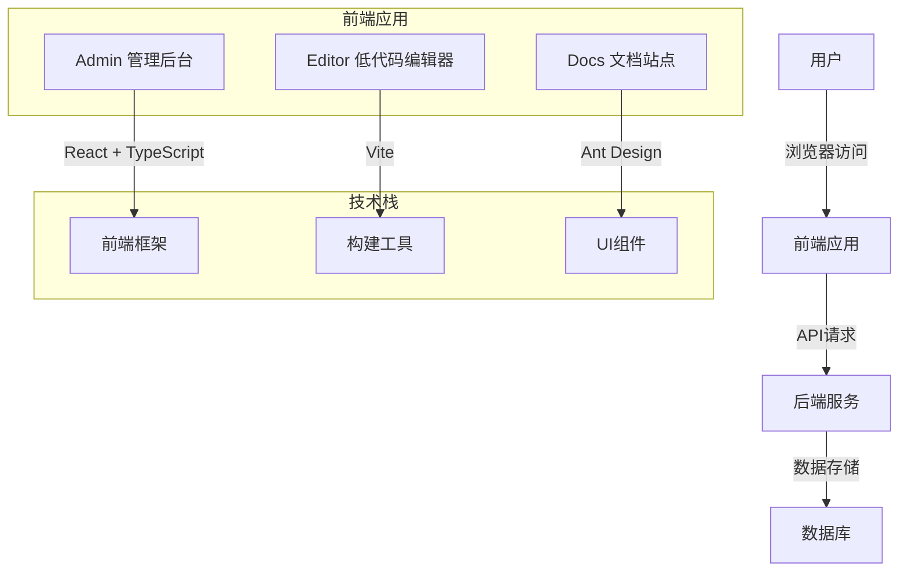
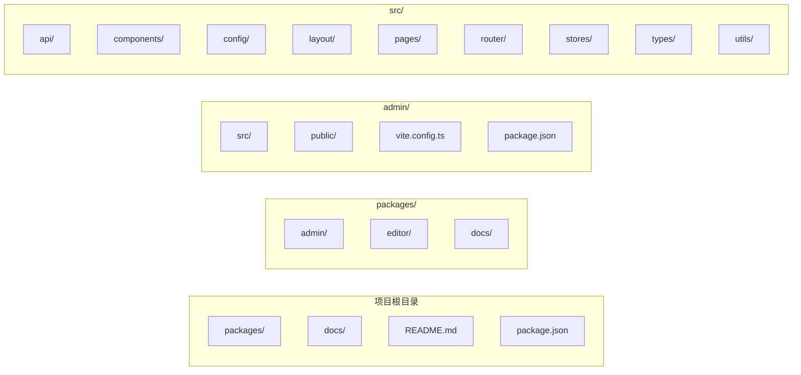
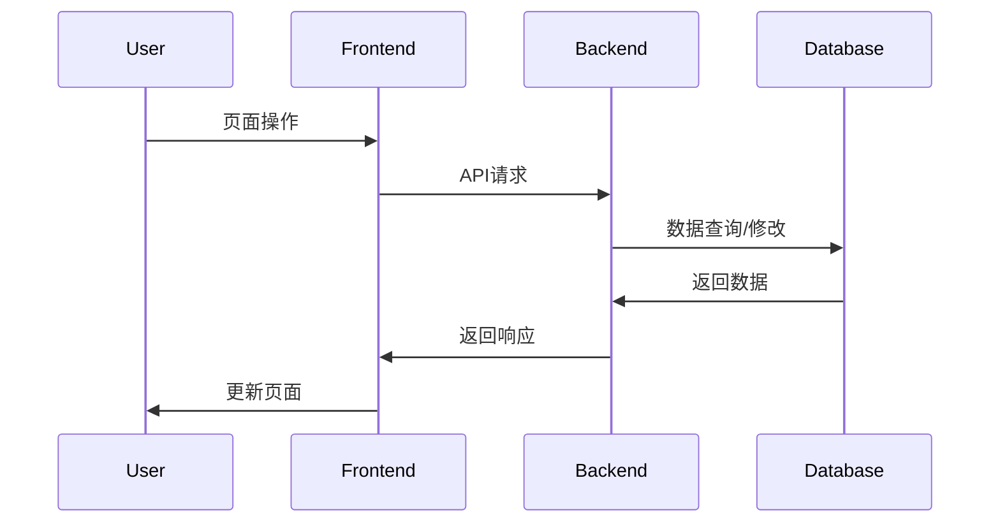
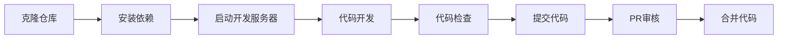
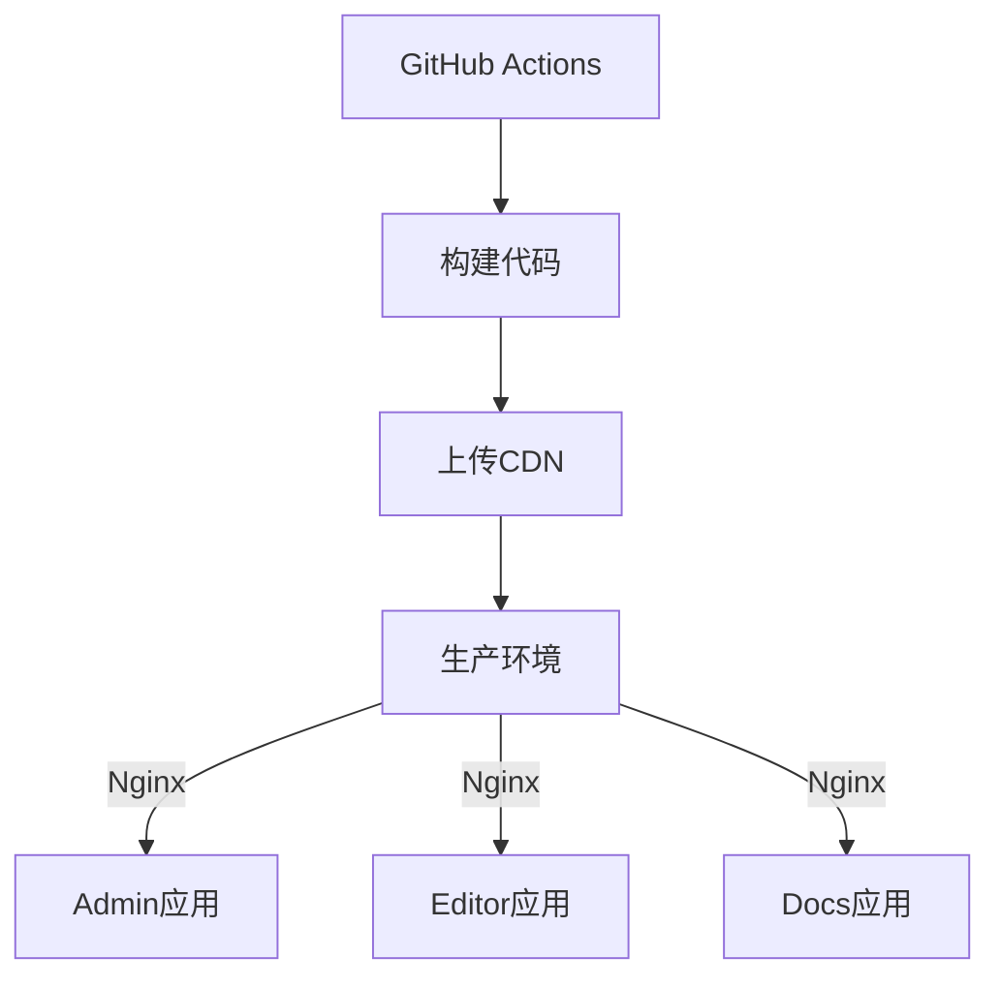

# MarsView 项目架构文档

## 1. 项目概述

MarsView 是一款开源的低代码平台，面向中后台管理系统。支持可视化配置、逻辑编排、事件流交互、数据源配置等。

## 2. 技术栈

- **前端框架**: React 18 + TypeScript
- **构建工具**: Vite
- **UI组件库**: Ant Design 5
- **状态管理**: Zustand
- **路由**: React Router DOM
- **样式**: Less + CSS Modules
- **HTTP客户端**: Axios
- **代码规范**: Prettier + ESLint

## 3. 项目架构

### 3.1 整体架构

### 3.2 模块架构

## 4. 核心模块说明

### 4.1 Admin 管理后台

- **功能**: 系统管理、用户管理、项目管理
- **技术栈**: React 18 + TypeScript + Vite + Ant Design
- **入口文件**: `packages/admin/src/main.tsx`

### 4.2 Editor 低代码编辑器

- **功能**: 可视化页面编辑、组件配置、逻辑编排
- **技术栈**: React 18 + TypeScript + Vite + Monaco Editor
- **入口文件**: `packages/editor/src/main.tsx`

### 4.3 Docs 文档站点

- **功能**: 项目文档、API文档、使用教程
- **技术栈**: VitePress
- **入口文件**: `packages/docs/index.md`

## 5. 数据流向

## 6. 开发流程

## 7. 部署架构

